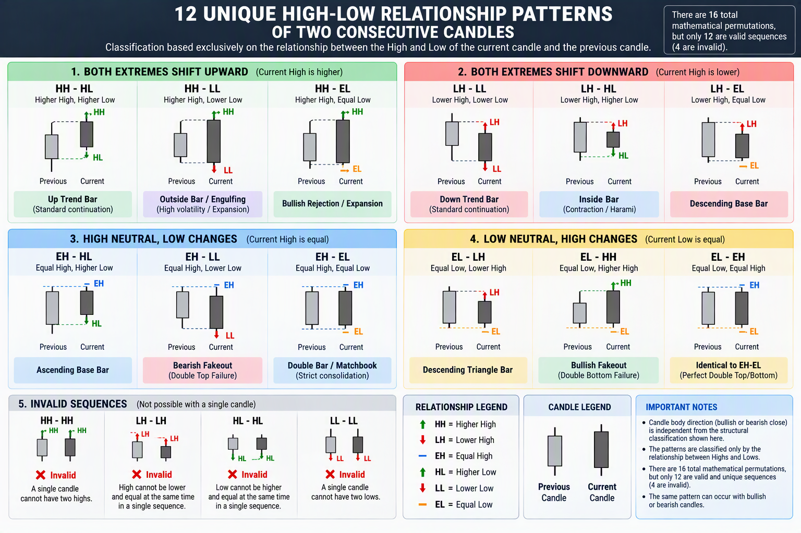

To capture all possible combinations of candlestick shapes in relation to the previous candle, we must look at the mathematical permutations of the Highs and Lows of two consecutive bars.
There are 16 total mathematical permutations based on how a current candle's High and Low compare to the previous candle's High and Low (Higher, Lower, or Equal).

Permutations of the Highs and Lows of two consecutive bars.

There are 16 total mathematical permutations based on how a current candle's High and Low compare to the previous candle's High and Low (Higher, Lower, or Equal).
Understanding the Naming Matrix

• HH / LH / EH: Current High is Higher / Lower / Equal to previous High.
• HL / LL / EL: Current Low is Higher / Lower / Equal to previous Low.

Out of the 16 Permutations , only 12 are valid sequences the are:



1. Both Extremes Shift Upward

• HH - HL: Higher High, Higher Low \(\rightarrow \) Up Trend Bar (Standard bullish continuation)
• HH - LL: Higher High, Lower Low \(\rightarrow \) Outside Bar / Engulfing (High volatility/Expansion)
• HH - EL: Higher High, Equal Low \(\rightarrow \) Bullish Rejection / Expansion

2. Both Extremes Shift Downward

• LH - LL: Lower High, Lower Low \(\rightarrow \) Down Trend Bar (Standard bearish continuation)
• LH - HL: Lower High, Higher Low \(\rightarrow \) Inside Bar (Contraction/Harami/Consolidation)
• LH - EL: Lower High, Equal Low \(\rightarrow \) Descending Base Bar

3. High Shifts Upward, Low is Neutral/Higher

• EH - HL: Equal High, Higher Low \(\rightarrow \) Ascending Base Bar
• EH - LL: Equal High, Lower Low \(\rightarrow \) Bearish Fakeout / Double Top Failure
• EH - EL: Equal High, Equal Low \(\rightarrow \) Double Bar / Matchbook (Strict consolidation)

4. High Shifts Downward, Low is Neutral/Lower

• EL - LH: Equal Low, Lower High \(\rightarrow \) Descending Triangle Bar
• EL - HH: Equal Low, Higher High \(\rightarrow \) Bullish Fakeout / Double Bottom Failure
• EL - EH: Equal Low, Equal High \(\rightarrow \) Identical to EH-EL (Perfect Double Top/Bottom)

5. Invalid sequences

• LH - LH: Lower High, Lower High \(\rightarrow \) Invalid single-candle sequence (High cannot equal Low)
• HL - HL: Higher Low, Higher Low \(\rightarrow \) Invalid single-candle sequence
• HH - HH: Higher High, Higher High \(\rightarrow \) Invalid sequence (A single candle cannot have two highs)
• LL - LL: Lower Low, Lower Low \(\rightarrow \) Invalid sequence

Quick-Reference Summary Table


High Comparison	Low Comparison	Code	Market / Candlestick Name
Higher	Higher	HH-HL	Up Trend Bar
Higher	Lower	HH-LL	Outside Bar / Engulfing
Higher	Equal	HH-EL	Bullish Expansion
Lower	Lower	LH-LL	Down Trend Bar
Lower	Higher	LH-HL	Inside Bar / Harami
Lower	Equal	LH-EL	Descending Base
Equal	Higher	EH-HL	Ascending Base
Equal	Lower	EH-LL	Double Top Rejection
Equal	Equal	EH-EL	Matching Highs/Lows (Tweezer)


## Pseudocode
```text
FUNCTION classifyRelationship(
    prevHigh,
    prevLow,
    currHigh,
    currLow
)

    //--------------------------------------------------
    // HIGH RELATION
    //--------------------------------------------------

    IF currHigh > prevHigh THEN
        highRelation = "HH"
    ELSE IF currHigh < prevHigh THEN
        highRelation = "LH"
    ELSE
        highRelation = "EH"
    END IF

    //--------------------------------------------------
    // LOW RELATION
    //--------------------------------------------------

    IF currLow > prevLow THEN
        lowRelation = "HL"
    ELSE IF currLow < prevLow THEN
        lowRelation = "LL"
    ELSE
        lowRelation = "EL"
    END IF

    //--------------------------------------------------
    // PATTERN CODE
    //--------------------------------------------------

    patternCode =
        highRelation + "-" + lowRelation

    //--------------------------------------------------
    // BUSINESS CLASSIFICATION
    //--------------------------------------------------

    SWITCH patternCode

        CASE "HH-HL":
            return (
                code="HH-HL",
                name="Up Trend Bar",
                category="Trend Continuation"
            )

        CASE "HH-LL":
            return (
                code="HH-LL",
                name="Outside Bar",
                category="Expansion"
            )

        CASE "HH-EL":
            return (
                code="HH-EL",
                name="Bullish Rejection / Expansion",
                category="Expansion"
            )

        CASE "LH-LL":
            return (
                code="LH-LL",
                name="Down Trend Bar",
                category="Trend Continuation"
            )

        CASE "LH-HL":
            return (
                code="LH-HL",
                name="Inside Bar",
                category="Contraction"
            )

        CASE "LH-EL":
            return (
                code="LH-EL",
                name="Descending Base Bar",
                category="Consolidation"
            )

        CASE "EH-HL":
            return (
                code="EH-HL",
                name="Ascending Base Bar",
                category="Consolidation"
            )

        CASE "EH-LL":
            return (
                code="EH-LL",
                name="Bearish Fakeout",
                category="Failure Pattern"
            )

        CASE "EH-EL":
            return (
                code="EH-EL",
                name="Double Bar / Matchbook",
                category="Balance"
            )

        CASE "EL-LH":
            return (
                code="EL-LH",
                name="Descending Triangle Bar",
                category="Consolidation"
            )

        CASE "EL-HH":
            return (
                code="EL-HH",
                name="Bullish Fakeout",
                category="Failure Pattern"
            )

        CASE "EL-EH":
            return (
                code="EL-EH",
                name="Perfect Double Top/Bottom",
                category="Balance"
            )

        DEFAULT:
            return (
                code="UNKNOWN",
                name="UNKNOWN",
                category="UNKNOWN"
            )

    END SWITCH

END FUNCTION
```


