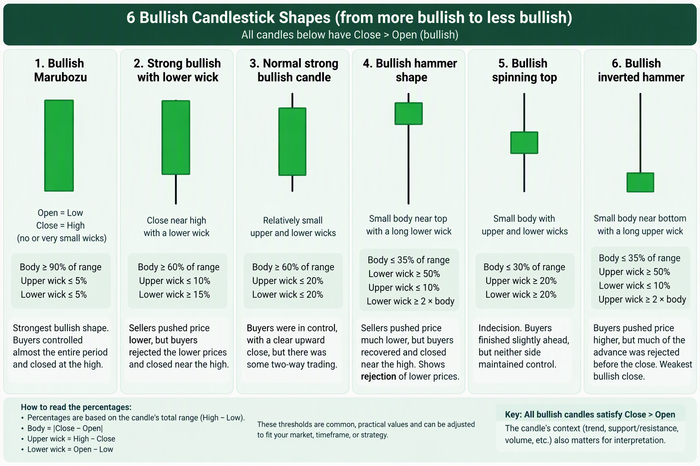
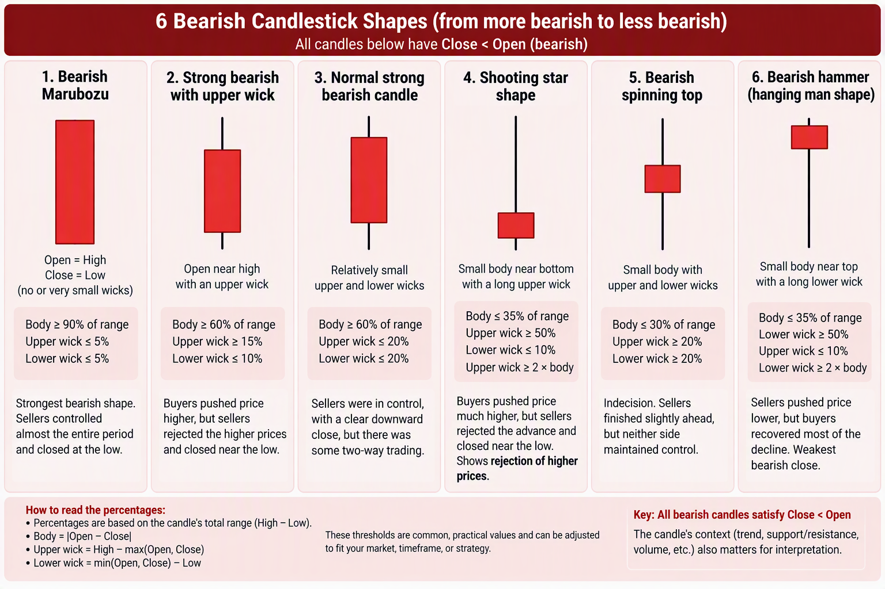

There is no universal industry standard for exact thresholds. The values below form a practical, configurable classification model. Published definitions agree that a Marubozu has no or negligible wicks, while practical implementations commonly treat each wick as less than approximately 5% to 10% of the candle’s range. They also recommend comparing the candle’s size with recent bars or ATR.

### Bullish shapes from most bullish to least bullish

1. Calculate the normalized Bullish candle dimensions

Given:

O = Open
H = High
L = Low
C = Close

For a bullish candle:

C > O

Calculate:

Range     = H - L
Body      = C - O
UpperWick = H - C
LowerWick = O - L

Validate:

Range > 0
Body > 0
UpperWick >= 0
LowerWick >= 0

The components must approximately satisfy:

Range = Body + UpperWick + LowerWick

Allow a small tolerance for floating-point and tick-size rounding.

Proportions of the candle
BodyRatio      = Body      / Range
UpperWickRatio = UpperWick / Range
LowerWickRatio = LowerWick / Range

Therefore:

BodyRatio + UpperWickRatio + LowerWickRatio = 1

Position of the close
CloseLocation = (C - L) / Range

Interpretation:

1.00 = close exactly at the high
0.90 = close in the top 10% of the range
0.50 = close at the midpoint

For a bullish candle:

CloseLocation = 1 - UpperWickRatio

Price-relative movement

Use a representative price, preferably the candle’s open or midpoint:

ReferencePrice = O
BodyPercent    = Body  / ReferencePrice * 100
RangePercent   = Range / ReferencePrice * 100

For consistency across gaps or low-priced assets, the OHLC midpoint is another option:

ReferencePrice = (O + H + L + C) / 4

Use the same reference consistently throughout your system.

2. Why one normalization method is not sufficient

Three different questions must be answered:

A. What is the candle’s shape?

Use proportions of Range:

BodyRatio
UpperWickRatio
LowerWickRatio

This tells you whether the candle looks like a Marubozu, hammer, spinning top, or inverted hammer.

B. How large was the actual price move?

Use percentage of the asset price:

BodyPercent = Body / O * 100

This makes a $2 body comparable between a $3 asset and a $100 asset.

C. Was the move unusually large for this asset and timeframe?

Use ATR or recent candle statistics:

BodyATR  = Body  / ATR(n)
RangeATR = Range / ATR(n)

A candle can have a perfect Marubozu shape but still be insignificant if its entire range is tiny compared with normal volatility. Sources describing practical Marubozu identification similarly distinguish wick proportions from whether the body is unusually large compared with recent bars or ATR.

Algorithmic classification

The following categories apply only when:

C > O

1. Strong bullish Marubozu
Shape conditions
BodyRatio      >= 0.90
UpperWickRatio <= 0.05
LowerWickRatio <= 0.05
CloseLocation  >= 0.95

Equivalent interpretation:

At least 90% of the full High-Low range is body.
No more than 5% is above the close.
No more than 5% is below the open.
The candle closes in the top 5% of its range.

A strict Marubozu has:

O = L
C = H

BodyRatio      = 1.00
UpperWickRatio = 0.00
LowerWickRatio = 0.00

Published practical definitions commonly accept wicks below approximately 5% to 10% of the total range as a near-Marubozu.

Magnitude conditions

The shape condition identifies a Marubozu, but not necessarily a large or significant one. Add at least one volatility condition:

RangeATR >= 0.80

Or:

Body >= 1.25 × median body of previous 20 candles

A stronger requirement could be:

RangeATR >= 1.00
Body >= 1.50 × median body of previous 20 candles

These are suggested configurable thresholds, not universal market definitions.

Example: $100 asset
O = 100.00
H = 102.05
L = 99.95
C = 102.00

Calculations:

Range     = 2.10
Body      = 2.00
UpperWick = 0.05
LowerWick = 0.05

BodyRatio      = 2.00 / 2.10 = 95.24%
UpperWickRatio = 0.05 / 2.10 = 2.38%
LowerWickRatio = 0.05 / 2.10 = 2.38%

BodyPercent = 2.00 / 100.00 = 2.00%

This qualifies as a strong bullish near-Marubozu by shape.

2. Strong bullish candle with lower-price rejection

This has a dominant bullish body, closes near the high, and has a meaningful lower wick.

Conditions
BodyRatio      >= 0.60
UpperWickRatio <= 0.10
LowerWickRatio >= 0.15
CloseLocation  >= 0.90

Optionally constrain the lower wick:

LowerWickRatio <= 0.35

This avoids classifying a hammer with a very small body as a momentum candle.

Interpretation

Suppose:

BodyRatio      = 65%
LowerWickRatio = 30%
UpperWickRatio = 5%

Price spent 30% of its total excursion below the open, but buyers recovered that decline and then produced a body covering 65% of the range. The 5% upper wick means the close retained almost all the upward progress.

This represents both:

bullish directional movement, measured by the 65% body;
rejection of lower prices, measured by the 30% lower wick.
3. Standard bullish momentum candle
Conditions
BodyRatio      >= 0.60
UpperWickRatio <= 0.20
LowerWickRatio <= 0.20
CloseLocation  >= 0.80

A stricter version:

BodyRatio      >= 0.70
UpperWickRatio <= 0.15
LowerWickRatio <= 0.15
CloseLocation  >= 0.85

Interpretation

Most of the candle’s range became permanent open-to-close progress rather than being retraced before the close.

Example:

BodyRatio      = 70%
UpperWickRatio = 10%
LowerWickRatio = 20%

The candle closes in the top 10% of its range:

CloseLocation = 90%

This is strongly bullish, but not a Marubozu because the lower wick is too large and the body does not occupy at least 90% of the range.

4. Bullish hammer-shaped candle

A hammer represents rejection rather than strong open-to-close momentum.

Conditions
BodyRatio       <= 0.35
LowerWickRatio  >= 0.50
UpperWickRatio  <= 0.10
CloseLocation   >= 0.90

Also require the lower wick relative to the body:

LowerWick >= 2 × Body

A stronger hammer can require:

LowerWick >= 3 × Body

Example proportions
BodyRatio      = 25%
LowerWickRatio = 70%
UpperWickRatio = 5%

The candle is bullish because C > O, but only 25% of the candle’s range is net upward progress. Its bullish quality comes principally from recovering a large downward excursion.

Therefore, it is useful to separate:

Momentum strength: low to moderate
Lower-price rejection: very strong

A hammer’s traditional bullish reversal interpretation also depends on appearing after a decline or around support. Candle shape alone does not establish that context.

5. Bullish spinning top
Conditions
BodyRatio       <= 0.30
UpperWickRatio  >= 0.20
LowerWickRatio  >= 0.20

To distinguish it from an almost neutral Doji, optionally require:

BodyRatio >= 0.05

Example:

BodyRatio      = 15%
UpperWickRatio = 40%
LowerWickRatio = 45%

Although C > O, only 15% of the total range became open-to-close progress. Both buyers and sellers moved price substantially, but neither maintained much control.

Published descriptions likewise treat a small real body as evidence of indecision rather than strong directional conviction.

6. Bullish inverted-hammer shape
Conditions
BodyRatio       <= 0.35
UpperWickRatio  >= 0.50
LowerWickRatio  <= 0.10

Also require:

UpperWick >= 2 × Body

Example proportions
BodyRatio      = 25%
UpperWickRatio = 70%
LowerWickRatio = 5%

The candle closed above its open, but most of the upward excursion was lost before the close.

Its close location is:

CloseLocation = 1 - 0.70 = 0.30

So price closed only 30% of the way from the low to the high. This is a weak raw bullish close, even though it can become a potentially bullish reversal pattern after a downtrend and with confirmation.

Solving the $2-wick problem

Consider two candles with a $2 wick.

Asset A: price approximately $100
WickPercent = 2 / 100 × 100 = 2%

Asset B: price approximately $3
WickPercent = 2 / 3 × 100 = 66.67%

Clearly, these moves are not economically equivalent.

But the wick should also be measured relative to the candle:

Asset A
Range = $10
Wick  = $2

WickRatio = 2 / 10 = 20%

Asset B
Range = $2.50
Wick  = $2

WickRatio = 2 / 2.50 = 80%

Therefore, preserve both values:

WickRatio   = Wick / CandleRange
WickPercent = Wick / ReferencePrice × 100
WickATR     = Wick / ATR

Each answers a different question:

WickRatio: What shape is the candle?
WickPercent: How large is the wick relative to the asset price?
WickATR: How unusual is the wick for this asset and timeframe?
Recommended classification sequence
1. Validate OHLC consistency.
2. Require Close > Open.
3. Calculate body and wick proportions against High-Low range.
4. Classify the geometric shape.
5. Measure body and range as percentages of price.
6. Compare range and body against ATR or recent median values.
7. Apply trend, support/resistance and volume context separately.

A concise ruleset could be:

if bodyRatio >= 0.90
   and upperWickRatio <= 0.05
   and lowerWickRatio <= 0.05:
       shape = "bullish_marubozu"

else if bodyRatio >= 0.60
   and upperWickRatio <= 0.10
   and lowerWickRatio >= 0.15:
       shape = "bullish_lower_rejection"

else if bodyRatio >= 0.60
   and upperWickRatio <= 0.20
   and lowerWickRatio <= 0.20:
       shape = "bullish_momentum"

else if bodyRatio <= 0.35
   and lowerWickRatio >= 0.50
   and upperWickRatio <= 0.10
   and lowerWick >= 2 * body:
       shape = "bullish_hammer"

else if bodyRatio <= 0.30
   and upperWickRatio >= 0.20
   and lowerWickRatio >= 0.20:
       shape = "bullish_spinning_top"

else if bodyRatio <= 0.35
   and upperWickRatio >= 0.50
   and lowerWickRatio <= 0.10
   and upperWick >= 2 * body:
       shape = "bullish_inverted_hammer"

else:
       shape = "unclassified_bullish"

The important distinction is that shape strength, absolute move significance, and volatility significance should remain separate outputs. Combining them into one label can make a tiny, irrelevant Marubozu appear equivalent to a large breakout candle.

Below is the bearish equivalent of the normalized bullish model. The key principle is unchanged: classify the shape using proportions of the candle range, then measure the economic magnitude against price, and finally measure the statistical magnitude against ATR or recent candles.

Published descriptions define a bearish candle as one where the close is below the open, and a bearish Marubozu as a candle opening at or near its high and closing at or near its low. Practical near-Marubozu definitions commonly allow each wick to occupy no more than approximately 5% to 10% of the entire candle range.

1. Normalized bearish candle anatomy

Given:

O = Open
H = High
L = Low
C = Close

A bearish candle requires:

C < O

Calculate:

Range     = H - L
Body      = O - C
UpperWick = H - O
LowerWick = C - L

Validate:

Range > 0
Body > 0
UpperWick >= 0
LowerWick >= 0

The components must satisfy:

Range = UpperWick + Body + LowerWick

Allow a small tolerance for tick-size and floating-point rounding.

Candle-shape proportions
BodyRatio      = Body      / Range
UpperWickRatio = UpperWick / Range
LowerWickRatio = LowerWick / Range

Therefore:

BodyRatio + UpperWickRatio + LowerWickRatio = 1

These ratios describe the candle’s geometry independently of whether the asset trades at $3, $100, or $50,000.

2. Location of the open and close

For bearish candles, it is useful to calculate both normalized locations.

Close location
CloseLocation = (C - L) / Range

Interpretation:

0.00 = close exactly at the low
0.05 = close in the bottom 5% of the range
0.10 = close in the bottom 10%
0.50 = close at the midpoint
1.00 = close at the high

For bearish candles:

CloseLocation = LowerWickRatio

Therefore, a smaller CloseLocation is more bearish.

Open location
OpenLocation = (O - L) / Range

Interpretation:

1.00 = open exactly at the high
0.95 = open in the top 5% of the range
0.50 = open around the midpoint

For bearish candles:

OpenLocation = 1 - UpperWickRatio

A strong bearish momentum candle normally combines:

High OpenLocation
Low CloseLocation
High BodyRatio

3. Normalize against the asset price

Use a consistent reference price:

ReferencePrice = O

Then calculate:

BodyPercent      = Body      / ReferencePrice * 100
RangePercent     = Range     / ReferencePrice * 100
UpperWickPercent = UpperWick / ReferencePrice * 100
LowerWickPercent = LowerWick / ReferencePrice * 100

For example, a $2 upper wick represents:

$100 asset: 2 / 100 × 100 = 2.00%
$3 asset:   2 / 3   × 100 = 66.67%

Consequently, dollar values should not be used by themselves to identify candle significance.

4. Normalize against recent volatility

Calculate:

BodyATR      = Body      / ATR(n)
RangeATR     = Range     / ATR(n)
UpperWickATR = UpperWick / ATR(n)
LowerWickATR = LowerWick / ATR(n)

For example:

RangeATR = 1.20

means the complete candle range is 1.2 times the selected ATR.

A candle can have perfect bearish Marubozu proportions while being economically insignificant if:

RangeATR = 0.15

Practical Marubozu identification therefore compares body or range size with recent candles or ATR, in addition to measuring wick proportions.

### Bearish shapes from most bearish to least bearish

Below is the bearish equivalent of the normalized bullish model. The key principle is unchanged: classify the shape using proportions of the candle range, then measure the economic magnitude against price, and finally measure the statistical magnitude against ATR or recent candles.

Published descriptions define a bearish candle as one where the close is below the open, and a bearish Marubozu as a candle opening at or near its high and closing at or near its low. Practical near-Marubozu definitions commonly allow each wick to occupy no more than approximately 5% to 10% of the entire candle range.

1. Normalized bearish candle anatomy

Given:

O = Open
H = High
L = Low
C = Close

A bearish candle requires:

C < O

Calculate:

Range     = H - L
Body      = O - C
UpperWick = H - O
LowerWick = C - L

Validate:

Range > 0
Body > 0
UpperWick >= 0
LowerWick >= 0

The components must satisfy:

Range = UpperWick + Body + LowerWick

Allow a small tolerance for tick-size and floating-point rounding.

Candle-shape proportions
BodyRatio      = Body      / Range
UpperWickRatio = UpperWick / Range
LowerWickRatio = LowerWick / Range

Therefore:

BodyRatio + UpperWickRatio + LowerWickRatio = 1

These ratios describe the candle’s geometry independently of whether the asset trades at $3, $100, or $50,000.

2. Location of the open and close

For bearish candles, it is useful to calculate both normalized locations.

Close location
CloseLocation = (C - L) / Range

Interpretation:

0.00 = close exactly at the low
0.05 = close in the bottom 5% of the range
0.10 = close in the bottom 10%
0.50 = close at the midpoint
1.00 = close at the high

For bearish candles:

CloseLocation = LowerWickRatio

Therefore, a smaller CloseLocation is more bearish.

Open location
OpenLocation = (O - L) / Range

Interpretation:

1.00 = open exactly at the high
0.95 = open in the top 5% of the range
0.50 = open around the midpoint

For bearish candles:

OpenLocation = 1 - UpperWickRatio

A strong bearish momentum candle normally combines:

High OpenLocation
Low CloseLocation
High BodyRatio

3. Normalize against the asset price

Use a consistent reference price:

ReferencePrice = O

Then calculate:

BodyPercent      = Body      / ReferencePrice * 100
RangePercent     = Range     / ReferencePrice * 100
UpperWickPercent = UpperWick / ReferencePrice * 100
LowerWickPercent = LowerWick / ReferencePrice * 100

For example, a $2 upper wick represents:

$100 asset: 2 / 100 × 100 = 2.00%
$3 asset:   2 / 3   × 100 = 66.67%

Consequently, dollar values should not be used by themselves to identify candle significance.

4. Normalize against recent volatility

Calculate:

BodyATR      = Body      / ATR(n)
RangeATR     = Range     / ATR(n)
UpperWickATR = UpperWick / ATR(n)
LowerWickATR = LowerWick / ATR(n)

For example:

RangeATR = 1.20

means the complete candle range is 1.2 times the selected ATR.

A candle can have perfect bearish Marubozu proportions while being economically insignificant if:

RangeATR = 0.15

Practical Marubozu identification therefore compares body or range size with recent candles or ATR, in addition to measuring wick proportions.

Bearish shapes from most bearish to least bearish
1. Strong bearish Marubozu
Strict geometric definition
O = H
C = L

Therefore:

BodyRatio      = 1.00
UpperWickRatio = 0.00
LowerWickRatio = 0.00
OpenLocation   = 1.00
CloseLocation  = 0.00

A strict bearish Marubozu opens at the candle high and closes at its low.

Practical near-Marubozu definition
BodyRatio      >= 0.90
UpperWickRatio <= 0.05
LowerWickRatio <= 0.05
OpenLocation   >= 0.95
CloseLocation  <= 0.05

Interpretation:

At least 90% of the High-Low range became open-to-close bearish movement.
No more than 5% of the range extends above the open.
No more than 5% extends below the close.
Price opened in the top 5% and closed in the bottom 5%.

Practical implementations often accept wicks under approximately 5% to 10% of the total range for a near-Marubozu.

Magnitude filters

To call it a significant strong candle, rather than merely a Marubozu-shaped candle, add:

RangeATR >= 0.80

Optionally use a stricter threshold:

RangeATR >= 1.00

Or compare it against recent bearish and bullish bodies:

Body >= 1.25 × median body of previous 20 candles

A stronger filter would be:

Body >= 1.50 × median body of previous 20 candles

These are suggested configurable engineering thresholds, not universal candlestick definitions.

Example
O = 100.00
H = 100.05
L = 97.95
C = 98.00

Calculations:

Range     = 100.05 - 97.95 = 2.10
Body      = 100.00 - 98.00 = 2.00
UpperWick = 100.05 - 100.00 = 0.05
LowerWick = 98.00 - 97.95 = 0.05

Ratios:

BodyRatio      = 2.00 / 2.10 = 95.24%
UpperWickRatio = 0.05 / 2.10 = 2.38%
LowerWickRatio = 0.05 / 2.10 = 2.38%

OpenLocation   = 97.62%
CloseLocation  = 2.38%
BodyPercent    = 2.00%

This qualifies as a strong bearish near-Marubozu by shape.

2. Strong bearish candle with upper-price rejection

This candle has a dominant bearish body, closes near the low, and contains a meaningful upper wick.

Conditions
BodyRatio      >= 0.60
UpperWickRatio >= 0.15
LowerWickRatio <= 0.10
CloseLocation  <= 0.10

Optionally constrain the upper wick:

UpperWickRatio <= 0.35

This separates a large-bodied bearish momentum candle from a shooting-star shape with a small body.

Example proportions
BodyRatio      = 65%
UpperWickRatio = 30%
LowerWickRatio = 5%

Because:

OpenLocation  = 70%
CloseLocation = 5%

price initially traded 30% of the range above the open, but sellers rejected that upward excursion and drove the close into the bottom 5% of the candle.

This candle contains two bearish characteristics:

Bearish directional movement = 65% body
Upper-price rejection        = 30% upper wick

3. Standard bearish momentum candle
General conditions
BodyRatio      >= 0.60
UpperWickRatio <= 0.20
LowerWickRatio <= 0.20
OpenLocation   >= 0.80
CloseLocation  <= 0.20

Stricter conditions
BodyRatio      >= 0.70
UpperWickRatio <= 0.15
LowerWickRatio <= 0.15
OpenLocation   >= 0.85
CloseLocation  <= 0.15

Example proportions
BodyRatio      = 70%
UpperWickRatio = 20%
LowerWickRatio = 10%

Therefore:

OpenLocation  = 80%
CloseLocation = 10%

The candle opened in the upper 20% of its range and closed in the bottom 10%. Most of its total excursion was preserved as bearish open-to-close progress.

It does not qualify as a Marubozu because:

BodyRatio < 90%
UpperWickRatio > 5%
LowerWickRatio > 5%

4. Bearish shooting-star shape

A shooting-star-shaped candle primarily represents rejection of higher prices, rather than strong open-to-close bearish momentum.

Conditions
BodyRatio      <= 0.35
UpperWickRatio >= 0.50
LowerWickRatio <= 0.10

Also require:

UpperWick >= 2 × Body

A stronger version can require:

UpperWick >= 3 × Body

Because it is a bearish candle:

C < O

Example proportions
BodyRatio      = 25%
UpperWickRatio = 70%
LowerWickRatio = 5%

This means:

OpenLocation  = 30%
CloseLocation = 5%

Interpretation:

Price advanced significantly above the open.
Sellers rejected most of that movement.
Price closed below the open and close to the low.
Only 25% of the total range became net bearish body movement.
The principal message is the 70% rejection wick.

Separate its two qualities:

Bearish momentum:         low to moderate
Upper-price rejection:   very strong

Its traditional bearish reversal interpretation is strongest after an advance or around resistance. The same geometry in another location does not automatically imply a bearish reversal.

5. Bearish spinning top
Conditions
BodyRatio      <= 0.30
UpperWickRatio >= 0.20
LowerWickRatio >= 0.20

To distinguish it from an almost bodyless Doji, optionally require:

BodyRatio >= 0.05

And, because this classification is bearish:

C < O

Example proportions
BodyRatio      = 15%
UpperWickRatio = 45%
LowerWickRatio = 40%

The candle closed below its open, but its body accounts for only 15% of the total price range.

This is better interpreted as:

Directional result: slightly bearish
Conviction:          low
Indecision:          high

A small real body indicates substantially less directional conviction than a large real body.

6. Bearish hammer or hanging-man shape

Geometrically, this candle has a small bearish body near the high and a long lower wick.

Conditions
BodyRatio      <= 0.35
LowerWickRatio >= 0.50
UpperWickRatio <= 0.10

Also require:

LowerWick >= 2 × Body

Example proportions
BodyRatio      = 25%
UpperWickRatio = 5%
LowerWickRatio = 70%

Therefore:

OpenLocation  = 95%
CloseLocation = 70%

Although the candle closed below its open, it closed in the upper 30% of the entire range. Sellers temporarily pushed the price much lower, but buyers recovered most of that decrease before the close.

Separate its qualities:

Bearish open-to-close result: yes
Bearish momentum:             weak
Lower-price rejection:        very strong

Its contextual name changes:

After an uptrend, it can be interpreted as a hanging man, which is a potential bearish warning requiring confirmation.
After a downtrend, the same geometry is a hammer, which is normally interpreted as potential bullish rejection.

For this reason, the raw-shape classifier should preferably call it:

small_bearish_body_long_lower_wick

Then a separate context classifier can assign hammer or hanging_man.

Suggested bearish ranking

Purely in terms of raw bearish closing strength:

MORE BEARISH
    |
    |-- Bearish Marubozu
    |-- Large body + upper rejection + close near low
    |-- Large body + small balanced wicks
    |-- Shooting-star shape
    |-- Bearish spinning top
    |-- Small bearish body + long lower wick
    |
LESS BEARISH

However, two distinct dimensions should be preserved:

1. Directional momentum
2. Price rejection

For example:

Bearish Marubozu:
    momentum = very strong
    upper rejection = none or minimal

Shooting star:
    momentum = low to moderate
    upper rejection = very strong

Long-lower-wick bearish candle:
    momentum = weak
    lower rejection = very strong and potentially bullish

Implementation-oriented classification

Order matters because some candle definitions overlap. Test the most specific categories first.

if C >= O:
    not a bearish candle

else:
    range     = H - L
    body      = O - C
    upperWick = H - O
    lowerWick = C - L

    bodyRatio      = body / range
    upperWickRatio = upperWick / range
    lowerWickRatio = lowerWick / range

    openLocation  = (O - L) / range
    closeLocation = (C - L) / range

Classification:

if bodyRatio >= 0.90
   and upperWickRatio <= 0.05
   and lowerWickRatio <= 0.05:
       shape = "bearish_marubozu"

else if bodyRatio >= 0.60
   and upperWickRatio >= 0.15
   and upperWickRatio <= 0.35
   and lowerWickRatio <= 0.10:
       shape = "bearish_upper_rejection_momentum"

else if bodyRatio >= 0.60
   and upperWickRatio <= 0.20
   and lowerWickRatio <= 0.20:
       shape = "bearish_momentum"

else if bodyRatio <= 0.35
   and upperWickRatio >= 0.50
   and lowerWickRatio <= 0.10
   and upperWick >= 2 * body:
       shape = "bearish_shooting_star_shape"

else if bodyRatio <= 0.30
   and upperWickRatio >= 0.20
   and lowerWickRatio >= 0.20:
       shape = "bearish_spinning_top"

else if bodyRatio <= 0.35
   and lowerWickRatio >= 0.50
   and upperWickRatio <= 0.10
   and lowerWick >= 2 * body:
       shape = "bearish_long_lower_wick"

else:
       shape = "unclassified_bearish"

Add magnitude independently
if rangeATR >= 1.50:
    magnitude = "exceptionally_large"
else if rangeATR >= 1.00:
    magnitude = "large"
else if rangeATR >= 0.50:
    magnitude = "normal"
else:
    magnitude = "small"

These magnitude bands are suggested configuration values and should be backtested for the asset class and timeframe.

Final output example

Instead of returning only:

bearish_marubozu

return structured information:

{
  "direction": "bearish",
  "shape": "bearish_marubozu",
  "body_ratio": 0.9524,
  "upper_wick_ratio": 0.0238,
  "lower_wick_ratio": 0.0238,
  "open_location": 0.9762,
  "close_location": 0.0238,
  "body_percent": 2.0,
  "range_percent": 2.1,
  "body_atr": 0.95,
  "range_atr": 1.0,
  "momentum_strength": "strong",
  "rejection_type": "minimal",
  "magnitude": "large"
}

This prevents three different concepts from being incorrectly merged:

shape      = What does the candle geometrically resemble?
momentum   = How effectively did sellers move price from open to close?
magnitude  = How large was the move relative to price and normal volatility?